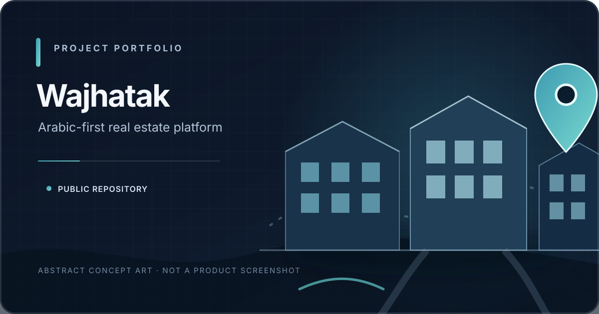
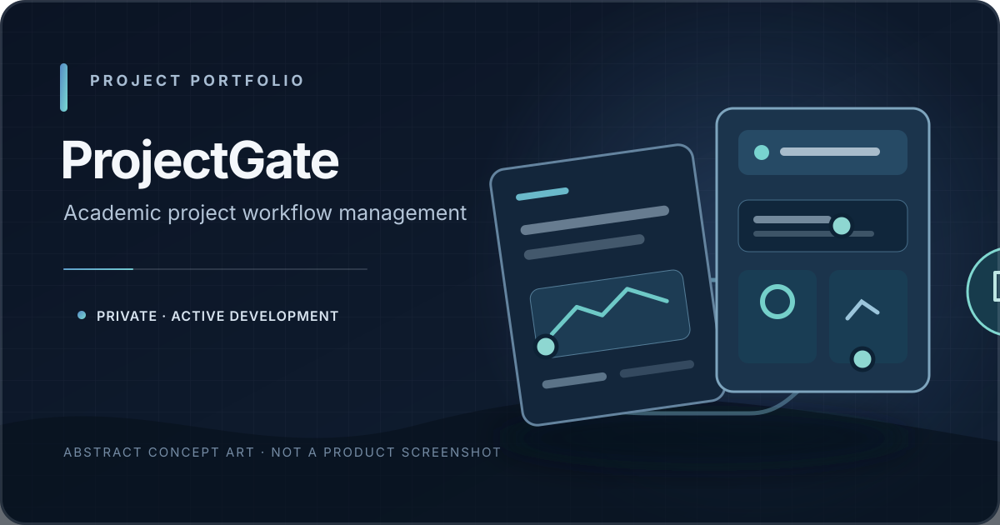
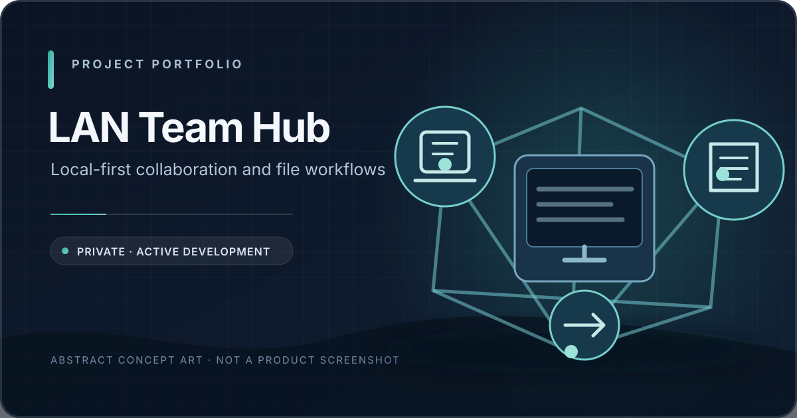
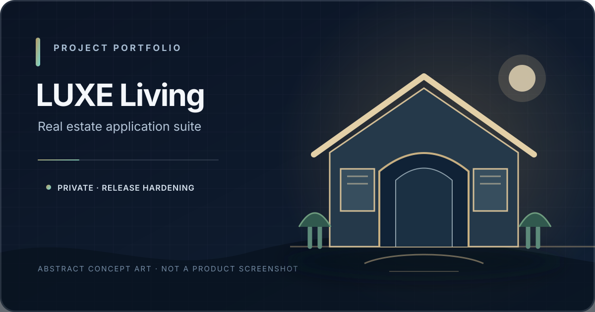

# Abdulrhman Saad Aljradi

**Software Engineer · Mobile & Web Application Development**

I build mobile applications, web platforms, and backend services with a focus on maintainable architecture, secure workflows, and practical product delivery.

صانع برمجيات أركز على تطوير تطبيقات الجوال والويب والأنظمة الخلفية، مع الاهتمام بجودة التنفيذ والأمان وقابلية الصيانة.

**Yemen** · **B.Sc. Computer Information Systems, Queen Arwa University — in progress**

[Email](mailto:aljrady591@gmail.com) · [GitHub](https://github.com/aljradi646)

---

## About

I work across the application stack: mobile and web interfaces, backend APIs, data models, authentication, authorization, and deployment workflows.

My current engineering focus includes:

- Flutter applications and responsive React interfaces.
- Laravel and Node.js backend services and REST APIs.
- Role-based and institution-aware authorization.
- Real-time communication, file workflows, and maintainable system architecture.
- Automated testing, CI, and production-focused quality.

I value verifiable implementation and clear technical trade-offs over inflated claims.

## Core technology stack

| Area | Technologies |
|---|---|
| Mobile | Flutter, Dart |
| Web | React, TypeScript, JavaScript, HTML, CSS |
| Backend | PHP, Laravel, Node.js, Python |
| APIs & real-time | REST APIs, WebSockets, Socket.IO, WebRTC |
| Data | MySQL, SQLite |
| Engineering tools | Git, GitHub Actions, Docker |

I select technologies according to the product's requirements rather than forcing one stack onto every project.

## Selected projects

<table>
  <tr>
    <td width="50%" valign="top">
      
      
<strong><a href="https://github.com/aljradi646/wajhatak-app">Wajhatak</a></strong> Public repository · Flutter, Dart, Laravel, PHP, MySQL

      
Arabic-first real-estate application for property discovery and management, backed by a Laravel API.

    </td>
    <td width="50%" valign="top">
      
      
<strong>ProjectGate</strong> Private · Active development · Laravel, React, TypeScript

      
Multi-institution graduation-project workflows covering role-aware workspaces, permissions, proposal review, supervision, and archiving.

    </td>
  </tr>
  <tr>
    <td width="50%" valign="top">
      
      
<strong>LAN Team Hub</strong> Private · Active development · Next.js, TypeScript, Fastify, Socket.IO, WebRTC

      
Local-first collaboration with device discovery, real-time communication, screen sharing, and resumable file transfer.

    </td>
    <td width="50%" valign="top">
      
      
<strong>LUXE Living</strong> Private · Further release hardening · Flutter, PHP, MySQL

      
Real-estate application suite combining mobile workflows, property management, and web administration.

    </td>
  </tr>
</table>

Project artwork is original conceptual illustration, not a screenshot of a running application. Private projects are not publicly available for source review; their inclusion does not imply that every feature is complete or production-deployed.

**Other private work:** CySaaS — an authorized web security assessment platform in active development; Sonara — an experimental AI-assisted audio-processing workflow.

## Engineering principles

- **Security first:** enforce authorization server-side, validate inputs, and protect institutional and tenant boundaries.
- **Maintainable architecture:** keep domain rules, application services, infrastructure, and presentation responsibilities clear.
- **Reliable data workflows:** use constraints, transactions, safe migrations, and idempotent operations where appropriate.
- **Responsive experience:** build accessible interfaces, including Arabic RTL layouts, across common screen sizes.
- **Evidence-based quality:** distinguish implemented behavior from planned work and verify important paths with tests and CI.
- **Honest delivery:** document limitations and operational requirements instead of presenting prototypes as finished products.

## Current focus

Strengthening enterprise application workflows, mobile/web integration, and reliable real-time systems.

## Contact

For professional opportunities and technical collaboration:

**[aljrady591@gmail.com](mailto:aljrady591@gmail.com)**

---

*Build deliberately. Test the behavior. Document the trade-offs.*

